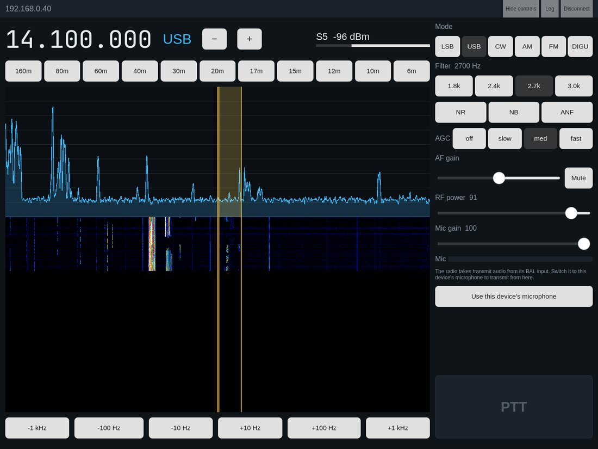
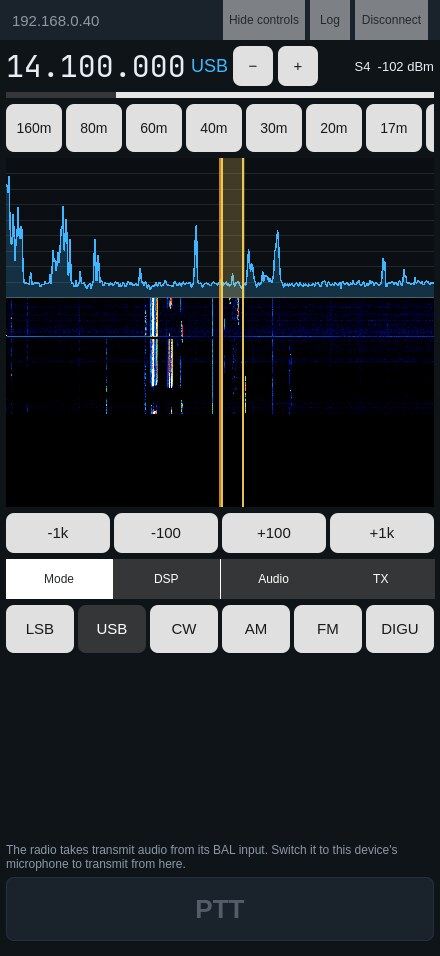
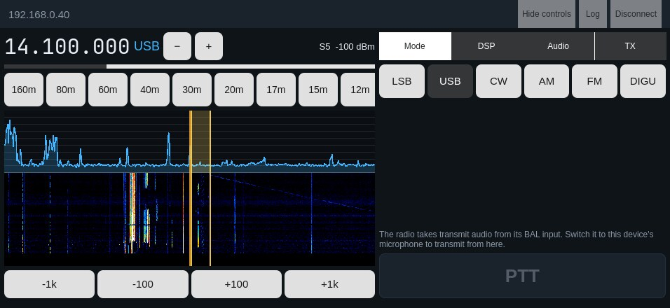
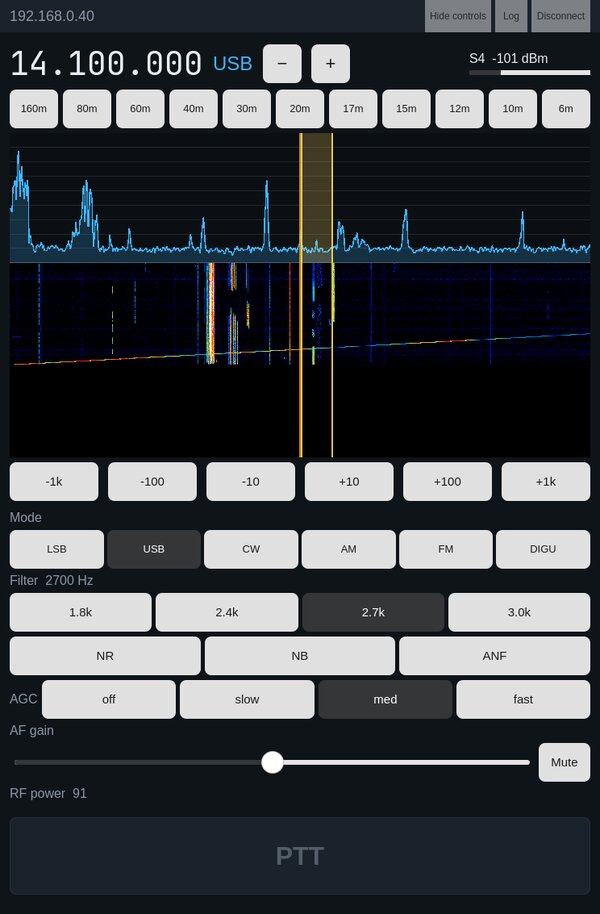
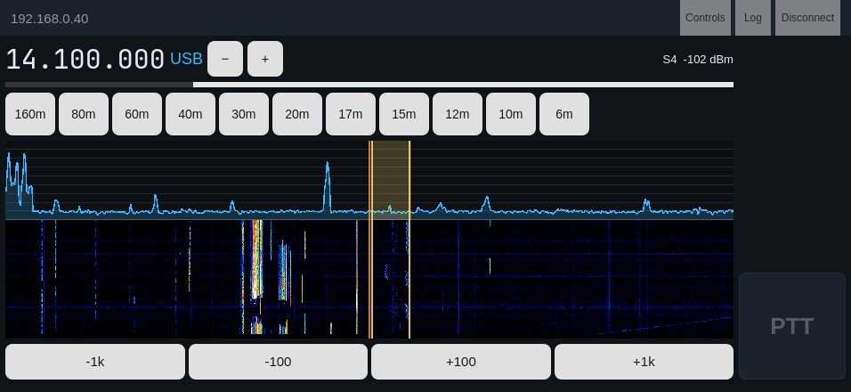
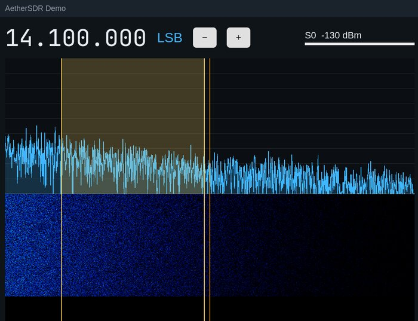

# AetherSDR Mobile

**An unofficial iPad and iPhone port of [AetherSDR](https://github.com/aethersdr/AetherSDR), the open-source FlexRadio client.**

[](https://github.com/OH6OKSA/AetherSDR/actions/workflows/mobile-ios.yml)


[](LICENSE)

AetherSDR Mobile runs the AetherSDR engine (`libaethercore`) on the iPad or
iPhone and talks to the radio directly. There is no PC, server, `aetherd` or
SmartSDR in between: if the device can reach the radio on the network, it is
a complete station control surface.

> This fork is maintained by Niko Oksa, OH6OKSA. It is **not** an official
> AetherSDR release. The aim is to offer the work upstream; see
> [discussion #6409](https://github.com/aethersdr/AetherSDR/discussions/6409).

<p align="center">
  
  &nbsp;
  
</p>

## Why

The desktop AetherSDR already runs on a Raspberry Pi. An iPad or iPhone has
more than enough CPU for the same engine, a better screen and a touch
interface. A tablet in the shack, or a phone on the couch, can be the whole
radio interface, with no computer running alongside.

## Features

**Receive**
- Live panadapter and waterfall. Tap to tune (snapped to the tuning step),
  drag to tune, pinch or use −/+ to zoom around the slice.
- Filter passband drawn on the display, on the correct side for USB/LSB and
  centred for CW/AM.
- Mode, filter width presets, NR/NB/ANF, AGC (off/slow/med/fast), AF gain and
  mute, S-meter.
- Band buttons use the radio's own band stack, so each band comes back to its
  last frequency and mode.
- Direct frequency entry from a keypad or a hardware keyboard.
- RX audio on the device. The screen stays awake while connected.

**Transmit**
- Hold-to-talk PTT from the device's microphone (the radio's mic input set to
  `PC`), with RF power, mic gain and mic level, plus forward power and SWR
  while transmitting. The microphone is open only while PTT is held.
- Safety first. Keying goes through AetherSDR's `TxController`, and every TX
  audio packet passes the engine's `TxCoordinator` dispatch fence. The
  transmitter unkeys on release, on disconnect, when the app loses focus,
  when the layout changes and when the mic input leaves the device.

**Made for the device**
- A tablet layout and a phone layout. They switch live on rotation, Split
  View, Stage Manager and folding (iPhone Duo).
- "Hide controls" gives the spectrum the whole screen. PTT stays, and the
  choice is remembered.
- Apple Pencil drags tune 10× finer, for zero-beating.
- Magic Keyboard and trackpad: arrows tune, Space is PTT, +/− zoom, F opens
  frequency entry, scroll tunes and ⌘-scroll zooms.
- Safe-area aware: notch, Dynamic Island and the home indicator.
- Built-in demo radio, so you can try it without a radio.
- In-app **Log** with Copy, so testers can report exactly what happened.

<p align="center">
  
  &nbsp;
  
</p>
<p align="center">
  
  &nbsp;
  
</p>

<sub>Screenshots are rendered by
[`mobile/tools/update-screenshots.sh`](mobile/tools/update-screenshots.sh) and
refreshed with every user-interface change.</sub>

## Status

| Area | State |
|---|---|
| Connect by IP, slice and panadapter, spectrum and waterfall, S-meter | ✅ Tested against a FLEX on SmartSDR API 1.4 |
| Mode, filters, DSP, AGC, band stack, RF power and mic level | ✅ Tested against a FLEX |
| iPad and iPhone builds, signing, TestFlight delivery | ✅ Automated in GitHub Actions |
| RX audio on device | 🧪 In beta testing |
| Pinch/−+ zoom and PTT hold on iOS | 🧪 Fixes in testing (builds 20–24) |
| Transmit on air | ⏳ Not yet verified. Test at low power or into a dummy load. |
| LAN discovery on iOS | ⏳ Needs Apple's multicast entitlement. Connect by IP for now. |

**Next:** confirm RX audio and TX on devices, offer upstreaming through an
RFC, add more controls (RIT/XIT, CW keying, more slices and pans), and
SmartLink for remote access.

## Try it

- **TestFlight beta.** Ask for an invitation at oh6oksa@gmail.com. You need
  iPadOS or iOS 18 or newer and a FlexRadio your device can reach (same
  network or VPN).
- **Build it yourself.** Linux or macOS works for development with the
  built-in demo radio; see [`mobile/README.md`](mobile/README.md):

  ```bash
  scripts/setup/setup-qt.sh
  cmake -B build-mobile -DAETHER_MOBILE=ON
  cmake --build build-mobile --target aether-mobile --parallel
  build-mobile/mobile/aether-mobile --demo
  ```

## How it is built

- **Same engine as the desktop.** The new CMake option `AETHER_MOBILE`
  builds `libaethercore` without QtWidgets or desktop peripherals. Desktop
  builds are unchanged, and the option is documented in
  [BUILD-OPTIONS.md](BUILD-OPTIONS.md).
- **New touch UI** in Qt Quick/QML under [`mobile/`](mobile/): the engine
  composition (`MobileEngine`), the spectrum and waterfall view (`SpectrumItem`), and the
  tablet and phone pages.
- **iOS support in core** is limited to platform guards. macOS-only
  IOKit/CoreAudio code sits behind `Q_OS_MACOS`, process helpers behind
  `QT_CONFIG(process)`, and the unused FFmpeg media plugin is excluded.
- **CI** ([`mobile-ios.yml`](.github/workflows/mobile-ios.yml)) builds on
  GitHub's macOS 26 runners with Xcode 26. It cross-compiles FFTW, archives
  the app and signs it with cloud-managed distribution signing through an App
  Store Connect API key. Each push uploads a build to TestFlight. No Mac is
  needed.
- Developed with Claude Code, following the upstream
  [constitution](CONSTITUTION.md) and [AGENTS.md](AGENTS.md) conventions.
  Commits are signed.

## Relationship to AetherSDR

All radio, DSP and protocol work is AetherSDR's: this fork adds a mobile
build option, iOS platform guards and a new touch client on top. For the
desktop application (Linux, macOS, Windows), downloads, supported radios and
the full feature list, see the upstream project:
**https://github.com/aethersdr/AetherSDR**

Upstream issue [#3128](https://github.com/aethersdr/AetherSDR/issues/3128)
plans a mobile client (AetherLink). This port is a standalone alternative,
and its QML client could also become an AetherLink thin client later.

## Privacy, license, contact

- Privacy: the app collects no data. See [mobile/PRIVACY.md](mobile/PRIVACY.md).
- License: GPLv3, like AetherSDR ([LICENSE](LICENSE), [THIRD_PARTY_LICENSES](THIRD_PARTY_LICENSES)).
- Contact: Niko Oksa, OH6OKSA, oh6oksa@gmail.com. 73!
