# AetherSDR Mobile — User Manual

AetherSDR Mobile turns an iPad or iPhone into a complete FlexRadio client:
panadapter and waterfall, all receive controls, transmit (voice, CW, tune)
and SmartLink remote operation, with no computer alongside.

This manual describes every function and how it works. The screenshots are
taken from the app connected to a real FLEX radio. The app's **Manual**
button (top row) opens this page.

- [1. Connecting](#1-connecting)
- [2. The main screen](#2-the-main-screen)
- [3. Frequency, mode and the info panel](#3-frequency-mode-and-the-info-panel)
- [4. Meters and slices](#4-meters-and-slices)
- [5. Panadapter and waterfall](#5-panadapter-and-waterfall)
- [6. Split](#6-split)
- [7. Transmitting: PTT, KEY and TUNE](#7-transmitting-ptt-key-and-tune)
- [8. Controls](#8-controls)
- [9. Radio Setup](#9-radio-setup)
- [10. Notices and problems](#10-notices-and-problems)
- [11. Keyboard and Apple Pencil](#11-keyboard-and-apple-pencil)
- [12. Reporting a problem](#12-reporting-a-problem)

---

## 1. Connecting

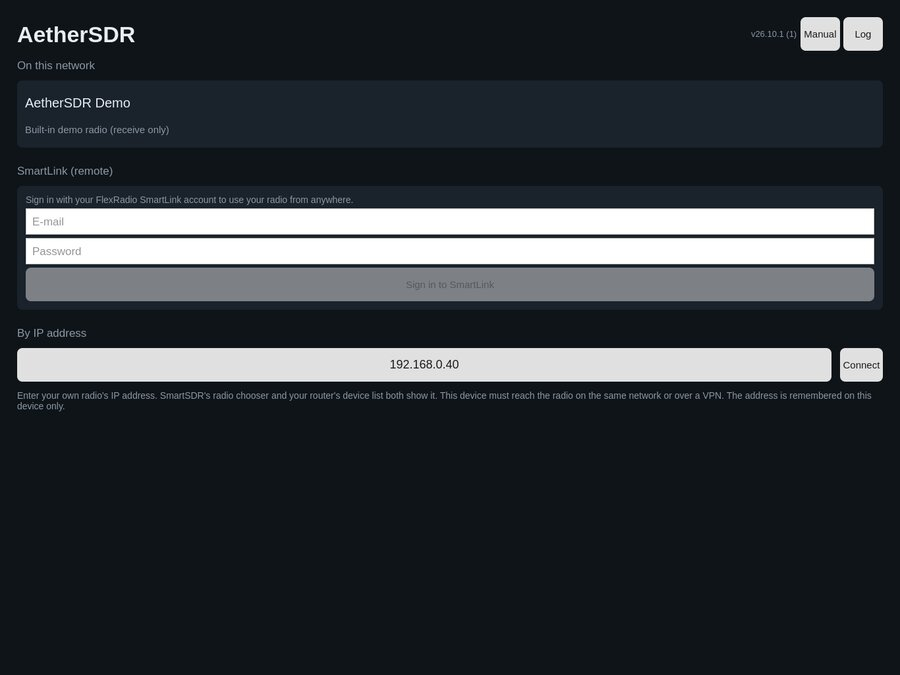

The first page lists the ways to reach a radio:

- **On this network** — FlexRadios found on the local network. Tap one to
  connect. *AetherSDR Demo* is a built-in receive-only demo radio for trying
  the app without a radio.
- **SmartLink (remote)** — sign in with your FlexRadio SmartLink account
  to use your radio from anywhere. The sign-in is kept in the iOS Keychain
  on this device only; the password is never stored.
- **By IP address** — tap the address field and enter your radio's IP
  address on the keypad (SmartSDR's radio chooser and your router's device
  list both show it), then *Connect*. A hardware keyboard works in the
  keypad too.
  The device must reach the radio on the same network or over a VPN.

The top row shows the app version, **Manual** and **Log** (see
[Reporting a problem](#12-reporting-a-problem)).

When you connect, the radio's microphone input is switched to *PC* so the
device's microphone can be used for transmit.

## 2. The main screen

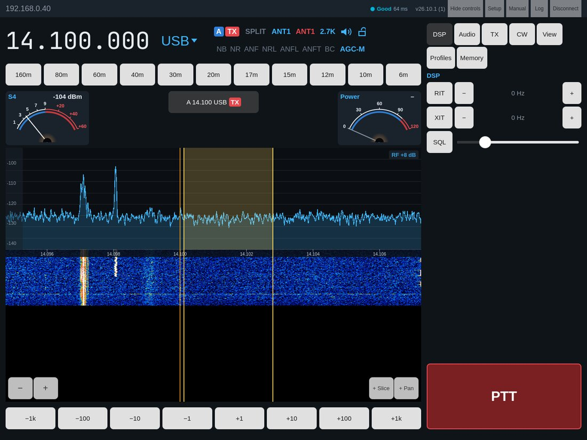

From top to bottom:

| Area | What it is |
|---|---|
| Top row | Radio name, [network quality](#network-quality), app version, **Controls** (open or hide the controls), **Setup** ([Radio Setup](#9-radio-setup)), **Manual**, **Log**, **Disconnect** (on an iPhone Setup, Manual, Log and Disconnect are behind **⋯**) |
| Frequency row | Frequency, mode, and the [info panel](#3-frequency-mode-and-the-info-panel) |
| Band buttons | 160 m … 6 m |
| Slice row | The two [meters](#4-meters-and-slices) at the ends, the slices in between |
| Panadapter and waterfall | The [spectrum display](#5-panadapter-and-waterfall) |
| Step buttons | Tune by −1 kHz … +1 kHz |
| PTT / KEY | [Transmit](#7-transmitting-ptt-key-and-tune) |

On an iPad the controls can stay pinned at the side (as above) or open as a
drawer. On an iPhone they open as a drawer from **Controls**.

| iPhone, portrait | iPhone, landscape |
|---|---|
| 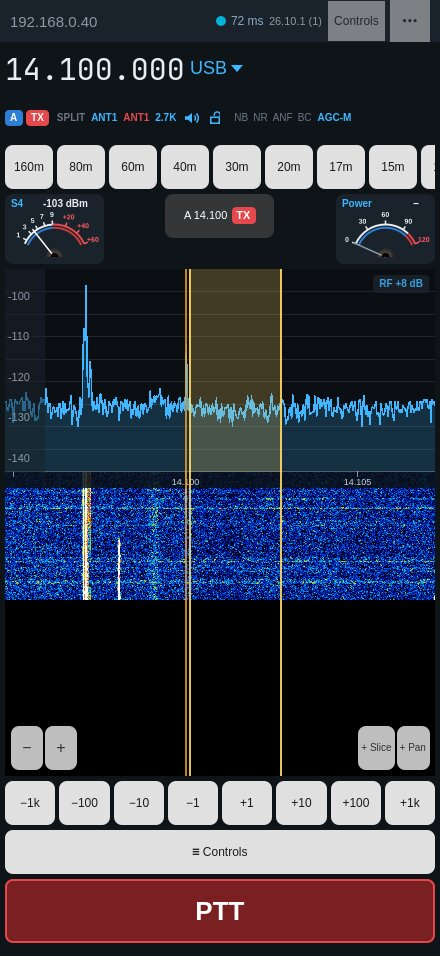 | 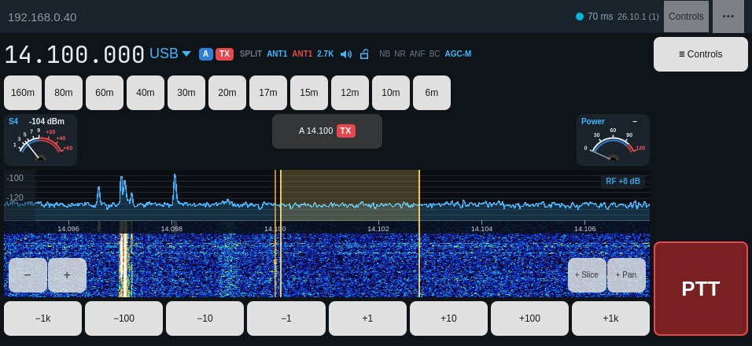 |

The layout follows the device: rotation, Split View, Stage Manager and
folding switch it live.

### Network quality

The dot in the top row rates the connection as the desktop AetherSDR does —
**Excellent / Very Good** (green), **Good** (blue), **Fair** (amber),
**Poor** (red) — with the round-trip time. On an iPhone only the dot and
the time show. Tap it for the details:

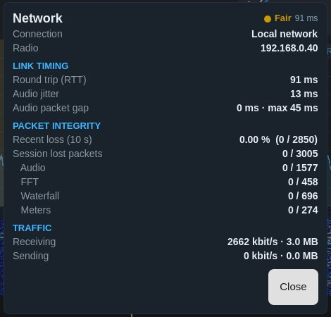

- **Link timing** — round trip to the radio, audio jitter, and the gap
  between audio packets (current and longest).
- **Packet integrity** — packets lost in the last 10 s and in the session,
  per stream (audio, spectrum, waterfall, meters). Packets that merely
  arrive out of order are not counted as lost.
- **Traffic** — receive and send rates and totals.

## 3. Frequency, mode and the info panel

**Frequency.** Tap the frequency for direct entry with a keypad (or type on
a hardware keyboard), then *Tune*.

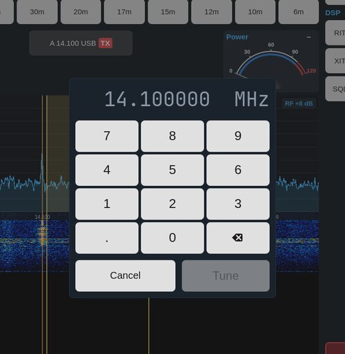

**Mode.** Tap the mode (e.g. *USB ▼*) and choose another.

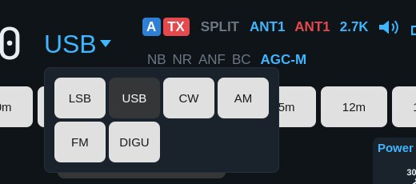

**Band buttons.** Each band returns to the frequency and mode you last used
there. The radio keeps these in its *band stack*, which is part of the
radio's global profile, so a different profile can bring a band back
elsewhere.

**Step buttons.** ±1 Hz … ±1 kHz, landing on round frequencies: +10 Hz from
14.100 002 goes to 14.100 010, not 14.100 012.

### The info panel

The active slice at a glance, after the slice flag of SmartSDR. Every item
is a touch target with its choices behind it:

| Item | Shows | Tap |
|---|---|---|
| **A** (blue) | Slice letter | — |
| **TX** (red) | This slice transmits | — |
| **SPLIT** | Split on (amber) or off (grey) | Start or end [split](#6-split) |
| **ANT1** (blue) | Receive antenna | Choose the RX antenna |
| **ANT1** (red) | Transmit antenna | Choose the TX antenna |
| **2.7K** | Receive filter width | Filters and DSP |
| Speaker | Audio on (blue) / muted (red) | Volume (AF gain) and Mute |
| Lock | Tuning lock open / locked | Lock or unlock tuning (flashes when a tune is refused) |
| **NB NR ANF NRL …** | Every DSP the radio offers, bright when on (on an iPhone the rarer ones only while on) | Filters and DSP |
| **AGC-M** | AGC mode | AGC mode, AGC threshold and RF gain |

On an iPhone the panel is one row (under the frequency in portrait).

**Filters and DSP** — the mode's eight filter widths (the active one dark;
choosing one closes the window) and the radio's DSP: NR, NB, ANF, APF (CW),
and NRL, ANFL, ANFT, NRS, RNN, NRF where the radio has them. **BC** is the
app's own beat cancel (below). DSP toggles leave the window open, so several
can be set together.

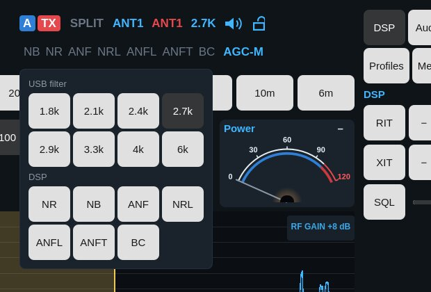

**BC — beat cancel**, as on Kenwood rigs: finds steady carriers in the
receive audio — someone tuning up on your frequency — and notches them out
within about 0.15 s, leaving voice alone. Up to four carriers at a time. Voice
modes only (it would remove the signal itself in CW and data modes).

**AGC** — off / slow / med / fast, the AGC threshold (AGC-T) and the
panadapter's RF gain (preamp or attenuator, in the radio's steps).

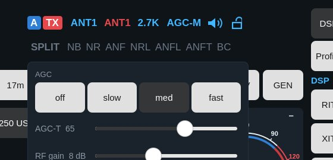

**Antennas** — the antenna ports the radio offers for receive or transmit.

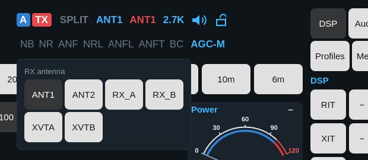

## 4. Meters and slices

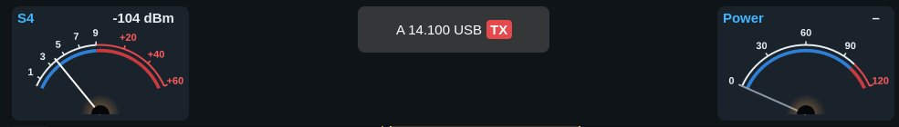

**Meters.** Two meters, at the ends of the slice row. Tap a meter to choose
what it shows — separately for receive and for transmit (e.g. S and Power,
then SWR and Power on the air) — and its style, bar or analog. Choices are
remembered.

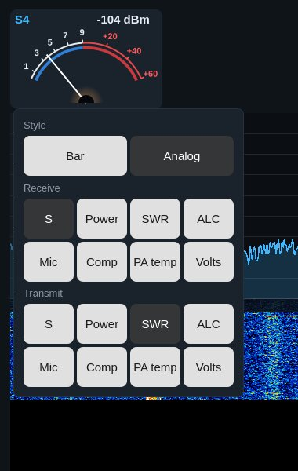

Available: S, Power, SWR, ALC, Mic, Compression, PA temperature, supply
voltage. Transmit meters read only while transmitting.

**Slices.** Each slice is a button between the meters ("A 14.100 USB"); the
transmit slice carries a red **TX** tag. Two fit side by side, four make
2 × 2.

- Tap a slice to make it the active one (tuning, info panel and controls
  follow it).
- Press and hold for **Make TX slice** and **Close slice**.
- **+ Slice** and **+ Pan** (bottom right of the waterfall) add a slice or a
  panadapter.
- Closing the transmit slice hands transmit to the slice that stays, so PTT
  keeps working.

## 5. Panadapter and waterfall

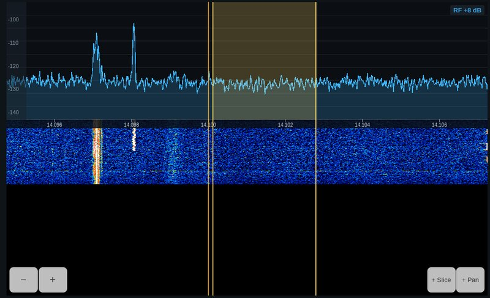

- **Tap** to tune to the touched point (on the tuning step).
- **Drag inside the filter passband** to tune; the slice follows the finger.
  Holding the finger at either edge keeps tuning, faster nearer the edge.
- **Drag anywhere else** to move the view; the frequency stays.
- **Pinch**, or **− / +** (bottom left), to zoom around the slice.
- The **frequency scale** runs along the top of the waterfall.
- The **dBm scale** at the left: drag it up or down to move the trace (the
  reference level).
- **RF +8 dB** (top right) shows the RF gain. A gain step shows on the
  waterfall and trace, as on the desktop.
- The filter passband is drawn on the display, on the correct side for
  USB/LSB and centred for CW/AM. Other slices are marked; tap one to select it.
- Your own transmission shows in the waterfall.
- In CW, decoded text runs along the top of the waterfall.

**View** (in Controls) switches between the 2D waterfall and the **3D**
stacked trace, and sets the waterfall's black level and colour gain and the
spectrum's reference and range (or Auto).

## 6. Split

Tap **SPLIT** on the info panel. As on SmartSDR and AetherSDR, a second slice
is created on the same panadapter for transmit:

- 1 kHz above in CW, 5 kHz above in other modes, same mode;
- it is muted (you listen on the original slice) and takes transmit;
- it becomes the active slice, so you can tune the transmit frequency at
  once (drag its passband, or the step buttons).

Tap **SPLIT** again — or close either slice — to end split: the transmit
slice closes and transmit returns to the receive slice.

## 7. Transmitting: PTT, KEY and TUNE

- **PTT** — hold to transmit from the device's microphone; release to stop.
  The microphone is open only while PTT is held.
- **KEY** — in CW modes the same button is a straight key (radio-side
  keyer and sidetone).
- **TUNE** (Controls → TX) sends a carrier at the tune power; while it is on,
  the big button reads TUNE and pressing it stops the carrier.

The button is always on top: an open controls drawer carries its own copy at
the bottom, so nothing ever covers it.

Safety: transmit goes through AetherSDR's TX controller. The transmitter
unkeys on release, on disconnect, when the app leaves the screen, when the
layout changes and when the microphone input leaves the device. If the radio
refuses to transmit, its reason pops up (for example *No transmit slice is
assigned* or *The selected TX antenna cannot transmit on this frequency*).

## 8. Controls

**Controls** (top row) opens the controls; on an iPad, *Pin controls to the
side* keeps them at the right, with toggle buttons to show several sections
at once.

| DSP | Audio | TX |
|---|---|---|
| 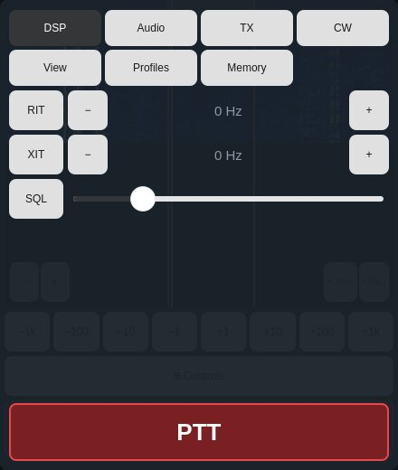 | 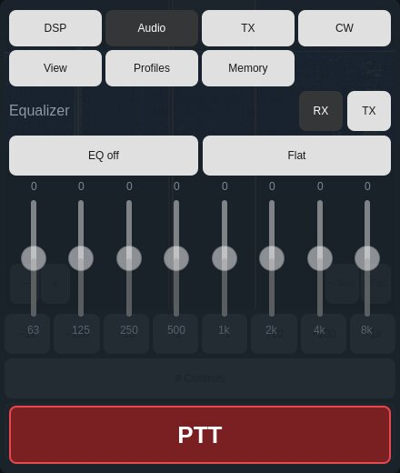 | 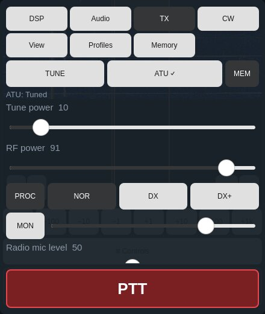 |

- **DSP** — RIT and XIT (on/off; − and + step 10 Hz and run while held,
  faster the longer: 10, then 50, then 100 Hz; tap the value to reset), and
  squelch.
- **Audio** — the radio's 8-band receive and transmit equalizer (volume is
  on the info panel's speaker).
- **TX** — TUNE and the ATU (tune, bypass, memories), tune power, RF power,
  speech processor (PROC NOR/DX/DX+), monitor (MON), radio mic level, device
  mic gain, microphone choice and the transmit filter (low and high cut).

| CW | View | Profiles | Memory |
|---|---|---|---|
| 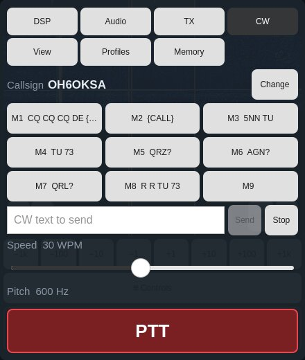 | 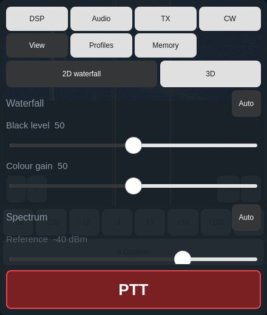 | 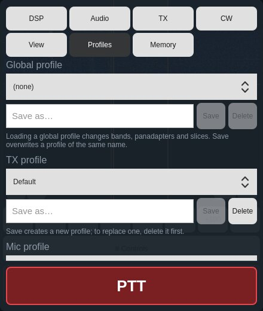 | 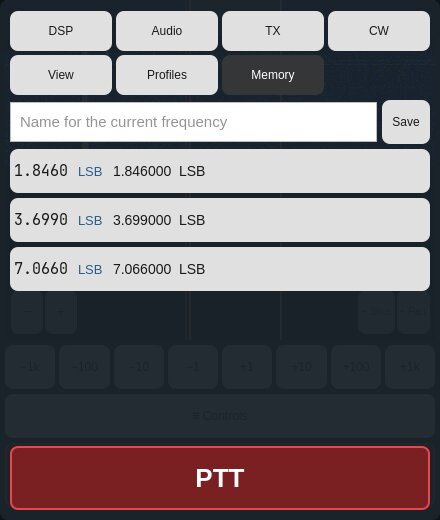 |

- **CW**
  - **Callsign** — the callsign `{CALL}` sends; *Set/Change* writes it to
    the radio (the same setting as SmartSDR's Radio Setup).
  - **Memories M1–M9** — tap to send (through the radio's CWX keyer at the
    set speed), press and hold to edit. `{CALL}` becomes your callsign.
  - **CW text** — type and *Send*; *Stop* clears what is still queued.
  - Speed, pitch, **Break-in** (QSK) and the **Decoder**. Decoded text shows
    here and along the top of the waterfall; what you send shows there too,
    marked `[TX]`.
- **View** — 2D waterfall or 3D, waterfall levels, spectrum range.
- **Profiles** — the radio's global, TX and mic profiles: load, save,
  delete, as in SmartSDR.
- **Memory** — the radio's memory channels: tap to tune, *Save* stores the
  current frequency, press and hold to delete.

## 9. Radio Setup

**Setup** in the top row (on an iPhone: **⋯** → *Radio Setup*) holds the
radio's own settings — the ones a radio needs on first use, as in SmartSDR's
and the desktop AetherSDR's Radio Setup. Every change is written to the
radio.

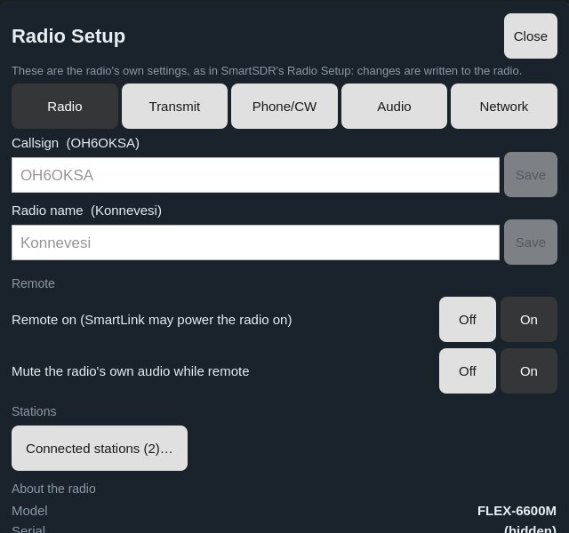

- **Radio** — callsign (what `{CALL}` sends), the radio's name in radio
  lists, *Remote on* (SmartLink may power the radio on), muting the radio's
  own audio while remote, and the model, serial, firmware, region and address.
- **Transmit** — maximum power, TX delay, transmit timeout (0 = off) and the
  TUNE signal (single or two tone).
- **Phone/CW** — microphone bias and boost; the CW keyer's break-in delay,
  iambic mode (off, A, B) and swapped paddles.
- **Audio** — the radio's line out and headphone levels and muting.

**A new radio.** When the app connects to a radio that has no callsign yet —
a new or reset radio — it offers *Set up* once, a few seconds after
connecting. *Later* skips it; Setup stays in the top row either way. A radio
that has a callsign never shows the offer.

## 10. Notices and problems

Notices and refusals pop up in the middle of the display; tap one, or wait
6 s, to close it. A tap elsewhere (PTT, tuning) never closes it by accident.

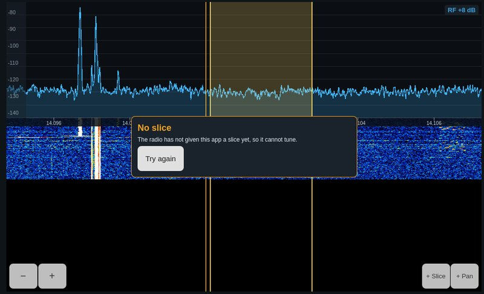

| You see | Why | What to do |
|---|---|---|
| **No slice** (frequency 0.000.000) | The radio did not give the app a slice. The app first retries once on a fresh panadapter; if it still fails, the radio's slices may all be in use by other programs | Close a slice there, then **Try again** |
| *No slice transmits* | No slice has transmit | Press and hold a slice → **Make TX slice** |
| *Interlock / did not accept the transmit request* | The radio refused to transmit; its reason is shown | Check TX antenna, band, other clients |
| A band button opens another band | The radio's band stack (in its global profile) holds that frequency | Tune the band where you want it and save the profile |
| *The radio has no callsign for {CALL}* | No callsign in the radio | Controls → CW → Callsign → *Set* |

## 11. Keyboard and Apple Pencil

With a Magic Keyboard or trackpad:

| Key | Action |
|---|---|
| ← / → | Tune |
| Space | PTT (hold) |
| + / − | Zoom |
| F | Frequency entry |
| Scroll | Tune; ⌘-scroll zooms |

**Apple Pencil** drags tune ten times finer, for zero-beating.

## 12. Reporting a problem

Open **Log** right after the problem, tap **Copy** (or **Share**) and send
the text together with your device model. The log header shows the app
version and build.
